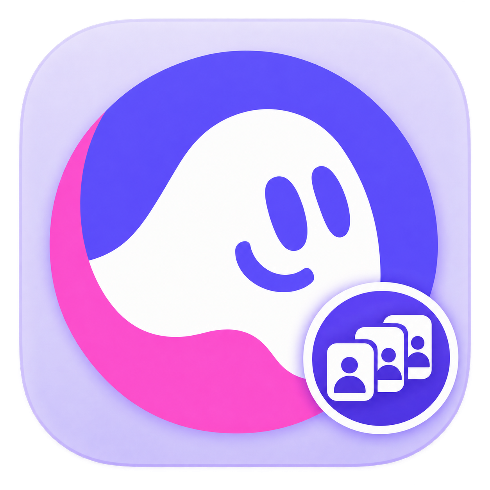

<p align="center">
  
</p>

# 扣子账号浏览器

## 一个窗口，多个扣子账号。

**各自登录，点击头像切换。** 把工作号、测试号和日常使用的账号放在同一个窗口里，不用反复退出登录、到处找不同的浏览器窗口。

支持 **5 个以上账号** · 独立保存登录资料 · 头像与昵称同步 · 可收起账号侧栏

**[下载最新版 2.3.1](https://github.com/Ian6733227/coze-account-browser/releases/latest)** · [第一次使用](#三步开始使用) · [详细使用与 CLI 说明](USAGE.md) · [反馈问题](https://github.com/Ian6733227/coze-account-browser/issues)

适用于 **Apple 芯片 Mac，macOS 13 或更高版本**。非扣子官方产品；当前安装包尚未经过 Apple 公证。未提供 Intel Mac、Windows 或 Linux 安装包。

## 给经常使用多个扣子账号的你

如果你会分别用不同账号测试 Agent、处理不同用途的工作，账号越多，越容易花时间辨认窗口和确认当前身份。

扣子账号浏览器把这些入口集中放在左侧，把当前账号的扣子网页显示在右侧。**切换入口，不用先退出另一个账号。** 各个账号仍需首次分别登录；实际登录身份以右侧扣子页面为准。

## 把多账号使用变得更顺手

| 你想做的事 | 在这里怎么做 |
|---|---|
| 同时使用多个扣子账号 | 为每个入口分别登录，登录资料各自保存在本机；支持添加五个以上入口。 |
| 快速找到要用的账号 | 点击左侧头像切换，也可使用 `⌘1` 至 `⌘9`；同步昵称、头像，或自定义名称和备注。 |
| 给网页留出更多空间 | 收起侧栏后保留头像，点击即可切换；“全部打开”仍显示文字。 |
| 切换后保留其他网页 | 已打开的账号网页可继续在后台运行；需要时点击“打开全部账号”。 |
| 暂时减少正在运行的网页 | 点击“暂停网页”关闭该账号页面并保留登录资料；可能中断页面工作，请先确认任务情况。 |
| 第一次使用，不知道哪里登录 | 应用内提供登录步骤、60 秒中文教程和 CLI 说明。 |

## 三步开始使用

1. **下载安装。** 在 [下载页](https://github.com/Ian6733227/coze-account-browser/releases/latest) 选择 `CozeAccountBrowser-2.3.1-macos-arm64.zip`，解压后把应用放入“应用程序”。不需要另外安装 Chrome 或 Node.js，也不用下载 Source code。
2. **分别登录。** 选择左侧账号，在右侧扣子网页自行登录；点击 `＋` 添加其他入口，再分别登录不同的账号。
3. **点击头像切换。** 后续在左侧选择要用的账号即可；需要操作提示时，点击“帮助与视频教程”。登录过期时仍需按扣子页面提示重新登录。

安装包使用 ad-hoc 本地签名。首次打开遇到 macOS 提示时，可参考 [Apple 官方打开说明](https://support.apple.com/zh-cn/102445) 和 [本项目安装说明](#下载与安装说明)。

## 2.3.1 有什么新变化？

- **退出免确认：** 普通退出直接关闭网页，保留登录资料。
- **按钮更好懂：** 收起侧栏也能看见“全部打开”，不再只有点阵图标。
- **更容易辨认账号：** 多账号应用图标、默认头像颜色和账号编号。
- **帮助就在应用里：** 离线登录指引、60 秒中文配音与字幕教程。
- **状态更清楚：** 区分网页未打开、暂停与加载失败，改善编辑期间的快捷键和列表焦点。

[完整版本说明](RELEASE-2.3.1.md) · [验证范围](VALIDATION-2.3.1.md) · [历史版本](https://github.com/Ian6733227/coze-account-browser/releases)

## 其他软件也能直接调用

内置本机 CLI，让其他软件直接列出账号、切换账号、打开扣子页面和查询网页状态，无需 Computer Use。

CLI 的范围是**账号与网页控制**，尚不能给扣子内部 Agent 下发任务、取消执行或获取结果。命令示例见 [CLI 控制说明](CONTROL-CLI.md)。

## 下载与安装说明

下载页附带 `SHA256SUMS.txt`，可运行以下命令核对文件完整性：

```sh
shasum -a 256 CozeAccountBrowser-2.3.1-macos-arm64.zip
```

安装包尚无 Developer ID 签名与 Apple 公证。确认下载来源和校验值后，可按 Apple 的提示处理首次打开；不要关闭系统整体安全保护。如果系统报告恶意软件或文件损坏，请停止使用并检查来源。升级时先正常退出旧版，再替换应用；保留账号资料目录。

## 使用前常见的几个问题

**普通浏览器不能用多个账号吗？**

普通浏览器也可以通过不同用户配置等方式使用多个账号。本工具的便利是把独立账号放在同一个窗口内，统一查看入口并点击头像切换。

**它一定比 Brave 更省内存吗？**

目前没有完成相同负载的内存对比，不作更省内存的承诺。同时打开的网页越多，通常越占资源；可以按需打开或暂停。

**关闭应用后，扣子的任务还会继续吗？**

本地网页会关闭。服务端任务是否继续由扣子决定，本工具不保证退出后任务仍在运行。重启默认打开第一个未隐藏账号，暂不恢复全部页面位置。

**下载包里会带上作者的账号吗？**

不会。使用者自行登录；公开下载包不含作者的账号列表、浏览器存储或聊天记录。不要把本机用户数据目录上传到仓库或 Issues。更多说明见 [隐私与数据](USAGE.md#隐私与数据)。

## 反馈与分享

欢迎把 [这个介绍页](https://github.com/Ian6733227/coze-account-browser) 发给同样需要多个扣子账号的 Mac 用户。[简短分享文案](PROMOTION.md) 可直接复制，支持改写。

遇到问题可在 [Issues](https://github.com/Ian6733227/coze-account-browser/issues) 留下应用版本、系统版本和脱敏后的复现步骤。开发、已知限制及图标来源见 [使用与开发说明](USAGE.md)。

本项目基于 Electron/Chromium。扣子/Coze 名称与图标归各自权利人，本工具与扣子官方无隶属关系。
